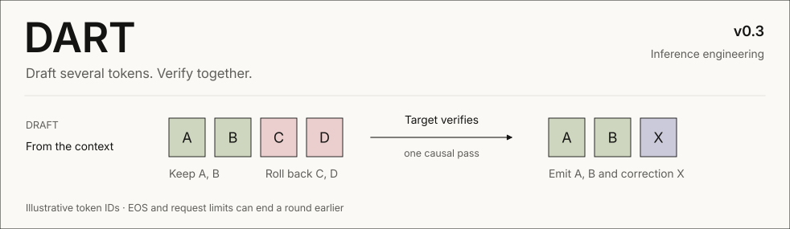
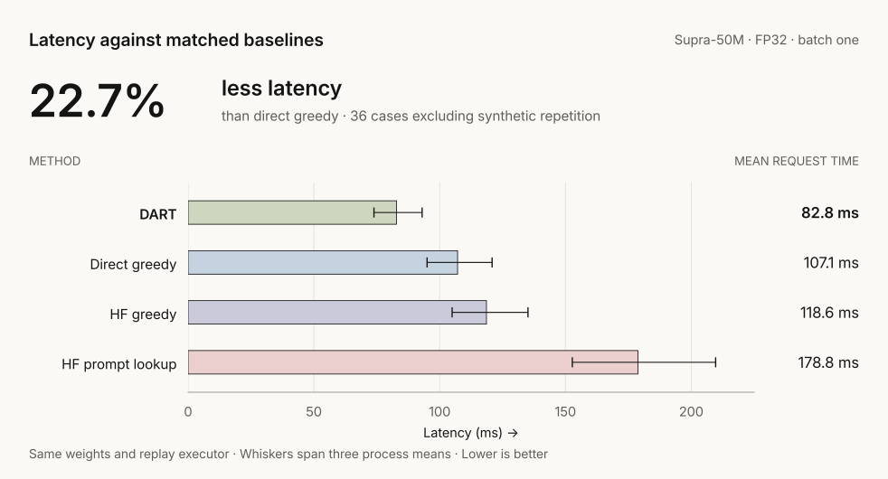
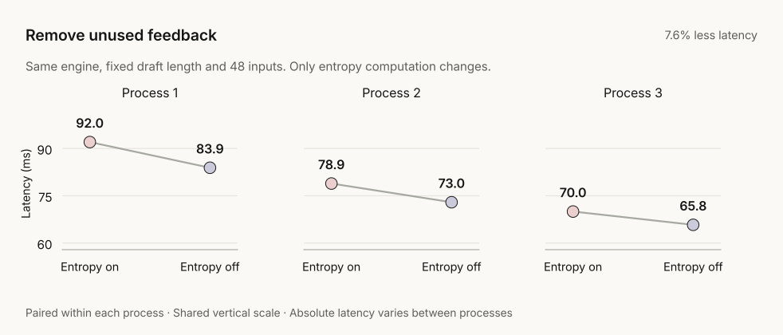
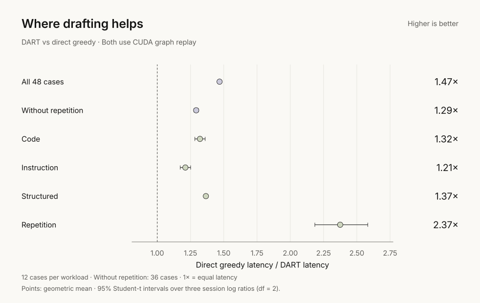
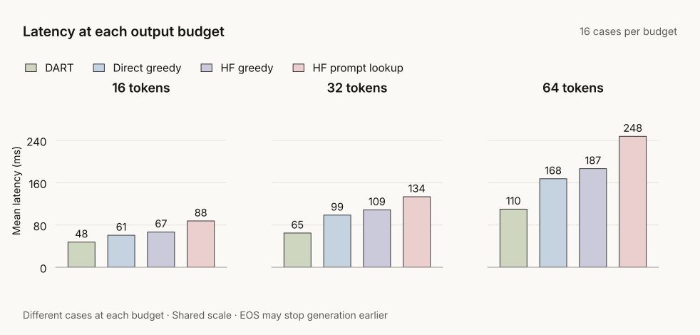
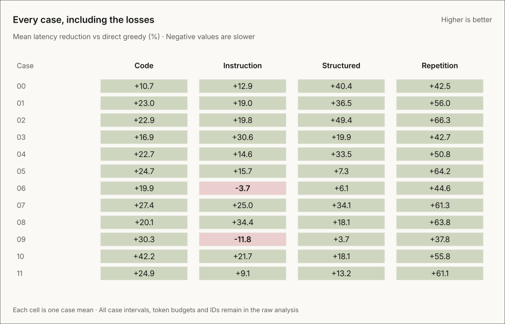

A small-model inference study: n-gram drafting, exact greedy verification and
an opt-in CUDA replay executor. **No extra learned weights.**

[Results](#results) · [How it works](#how-it-works) · [All cases](#all-cases) · **[Run & reproduce →](docs/reproduce.md)**

## Results

**[Overhead update: 7.0% lower latency](docs/reproduce.md#overhead-validation)**
against the matched prior implementation on 16 development cases. Three case
means were slower. The charts below retain the separate, frozen 48-case study.

**22.7% lower mean latency than direct greedy, excluding synthetic repetition.**

Supra-50M · RTX 5060 Laptop · FP32 · batch one · warm requests.
48 fresh cases, seven methods, three processes. One model and one machine.

Same weights, precision and replay executor. HF keeps its generation loop;
both lookup methods use four-token drafts and a maximum n-gram of four.

$$
\text{latency reduction} = 1 - \frac{\overline{T}_{\mathrm{DART}}}{\overline{T}_{\mathrm{greedy}}} \approx 22.7\%
$$

Mean request times are **82.83 vs 107.12 ms**. The paired geometric speed ratio
is **1.293× [1.276, 1.309]**: a descriptive 95% interval over three process means.

## How it works

The target checks a draft in one causal pass. For prefix $`x`$ and draft
$`d_1,\ldots,d_k`$, its greedy choices are

$$
y_i = \arg\max_{v} P_\theta\!\left(v \mid x, d_{1:i-1}\right).
$$

Keep the longest matching prefix. On a mismatch, emit the target's correction;
on a full match, emit its bonus token. **An accepted EOS stops immediately.**
Output and context limits also bound each round.

The [replay executor](dart/models/replay.py) reuses captured execution while
keeping request-owned KV snapshots, masking unused positions and rolling back
rejected tokens. Eager execution remains the default.
[Separate replay ablation →](docs/figures/v0.3-execution/ablation.svg)

**Skipping unused entropy saves 7.6%** in the matched on/off ablation.
Consumers still receive it. Fixed4 averages **74.2 ms**, fixed2 **79.3 ms**,
and the existing TimeScheduler **84.2 ms** with the same optimization.
Fixed4 was selected on development inputs.

## Across workloads

All four workload means improve. Including repetition gives **31.9% lower
latency** overall; that workload contributes **47.6% of saved time**.

Each budget contains different cases. These are observed means, not a controlled
length sweep; EOS can stop generation before the budget.

## All cases

**46/48 case means win.** The two losses take **3.7% and 11.8% longer**;
both case intervals cross parity. Every timing and natural EOS case is retained.
[Case intervals, IDs and budgets →](benchmarks/results/v0.3-feedback/analysis.json)

## Evidence

| Output agreement | Reproduction | Resources |
|:---|:---|:---|
| **4,176 / 4,176** complete sequences | **352** fresh-install validation matches | **0** added parameters |
| IDs, lengths and EOS; five natural EOS cases | Five charts rebuilt identically from the wheel | **0.589 GiB** peak allocation |

Warm timings exclude preparation. Allocation includes two model copies and
shared workspaces. Bar whiskers are process ranges, not confidence intervals.
No independent reproduction, GPU kernel timeline, answer-quality or
compiled/larger-model result is claimed.

**[Reproduce the results →](docs/reproduce.md)** · [Raw sessions](benchmarks/results/v0.3-feedback) ·
[Development & alternatives](benchmarks/results/v0.3-feedback/development.json)

The [earlier execution study](benchmarks/results/v0.3-execution) uses different
inputs. Its result is separate; only the matched entropy ablation isolates the
new **7.6%** change.

[Apache-2.0](LICENSE) · [Dataset attribution](benchmarks/fixtures/feedback-sources.json) · [Cite DART](CITATION.cff)
