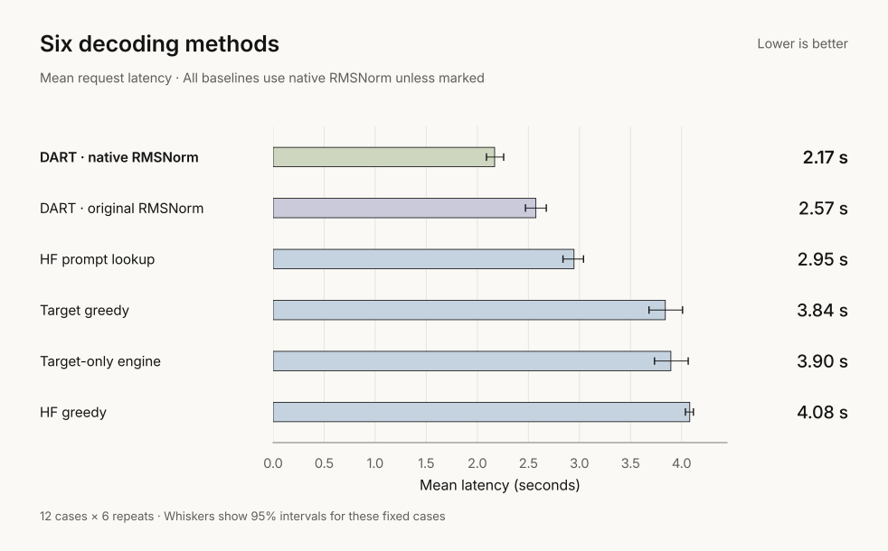
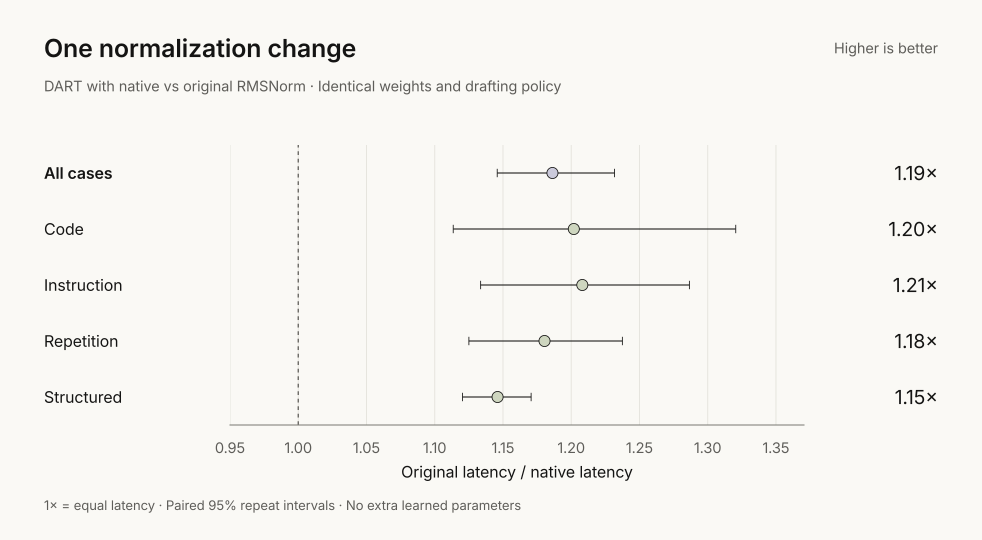
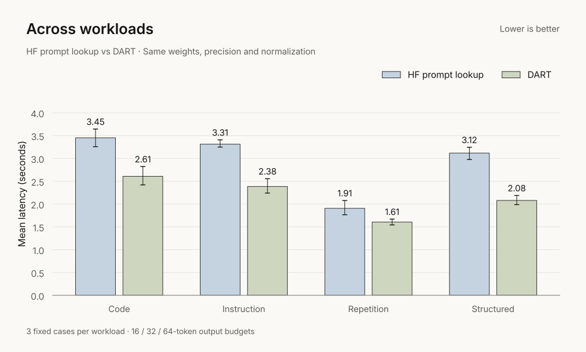
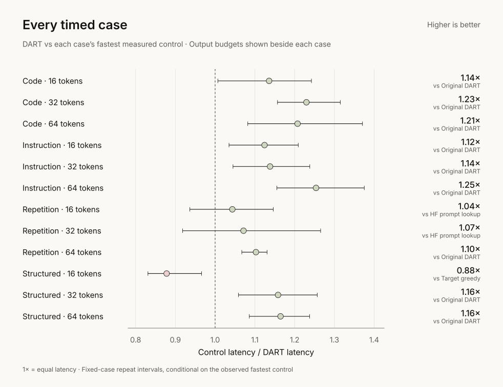

<h1 align="center">DART v0.3</h1>

  <strong>Draft several tokens. Verify them together.</strong> 
  Measured greedy decoding on a 51.8M-parameter model. No extra learned weights.

  <a href="#decoding-speed">Results</a> ·
  <a href="#verified-drafting">Method</a> ·
  <a href="docs/reproduce.md">Run &amp; reproduce</a> ·
  <a href="#evidence">Evidence</a>

| vs HF prompt lookup | Normalization change | Full-output agreement |
|:---:|:---:|:---:|
| **1.36×** | **15.7% less latency** | **24 / 24** |
| Mean request speedup | Same DART, original vs native norm | Held-out greedy checks |

Supra-50M · RTX 5060 Laptop · FP32 · batch one. Timing uses 12 fixed cases,
six repeats and six methods. These results describe one model and machine.

## Decoding speed

**2.17 seconds per request; 17.21 tokens/s.** DART uses four-token n-gram
drafts. HF prompt lookup gets the same draft budget and native normalization.
Weights, tokenizer, precision, attention backend and output limits match.

$$
S = \frac{\overline{T}_{\mathrm{HF\ lookup}}}{\overline{T}_{\mathrm{DART}}}
= 1.358 \quad [1.279,\ 1.439]
$$

The 95% interval measures repeat variation on these fixed cases.
Original-norm DART is the strongest aggregate control: **1.19×** against it.

## One measured change

**Profiling pointed to repeated RMSNorm work.** An opt-in path uses
[PyTorch RMSNorm](https://docs.pytorch.org/docs/2.11/generated/torch.nn.functional.rms_norm.html)
with the original weights and epsilon. Paired held-out requests show
**15.7% lower latency**; no custom kernel or learned drafter was added.

This path supports FP32 Llama norms. Floating-point results can differ;
full-output checks cover the tested inputs. GPU kernel tracing was unavailable,
so the speed claim comes from synchronized request timing.

## Across workloads

**Lower mean latency in all four groups.** The frozen timing set contains
nine MBPP/Dolly inputs and three procedural inputs, with 16/32/64-token budgets.
Selection preceded validation and test outputs.

## Every timed case

**11/12 case means beat every control.** The short structured case takes
**13.9% longer than direct greedy**. All 12 means beat HF prompt lookup, but
three case intervals include 1×. The fastest-control intervals above are
conditional on the observed winner.

## Verified drafting

**Copy a draft → verify → keep the matching prefix → correct or continue.**

For prefix $p$ and drafts $d_1,\ldots,d_K$, a causal target pass computes

$$
t_i = \underset{v}{\arg\max}\;P_\theta(v\mid p,d_{<i}),
\qquad \mathrm{commit}=(d_1,\ldots,d_m,t_{m+1})
$$

Here $m$ is the matching prefix length. A mismatch gives a correction;
a full match gives a bonus token. Accepted EOS stops immediately, without
a bonus. Rejected cache entries are cropped; the final emitted token stays
pending for the next pass. Output and context limits bound every round.

## Evidence

| Check | Recorded scope |
|:---|:---|
| Correctness | 24 complete outputs vs original HF greedy; one natural early EOS |
| Timing | 432 verified requests; one warm-up; six repeats; rotating method order |
| Memory | 0.513 GiB peak PyTorch allocation, with both target copies resident |
| Data | Frozen pilot / validation / test splits; source and family deduplication |
| Reproduction | Public commands, raw timings, model hashes and figure inputs |

No answer-quality, CPU speed or larger-model claim. Native normalization is
optional; agreement on these cases does not prove universal numerical
equivalence. Independent reproduction is still pending. Earlier v0.2 results
use different workloads and baselines, so they are not a direct version comparison.

[Protocol](benchmarks/results/v0.3/protocol.json) ·
[Raw timings](benchmarks/results/v0.3/benchmark.json) ·
[Full outputs](benchmarks/results/v0.3/correctness.json) ·
[Profiles](benchmarks/results/v0.3/profiles.json) ·
[Pilots & failures](benchmarks/results/v0.3/validation.json)

**[Run the checks, benchmark and chart commands →](docs/reproduce.md)**

Built on [speculative decoding](https://arxiv.org/abs/2211.17192), with
[HF prompt lookup](https://huggingface.co/docs/transformers/assisted_decoding)
as the closest measured baseline.

[Apache-2.0 code](LICENSE) · [Dataset attribution](benchmarks/fixtures/v0.3-sources.json) ·
[Cite DART](CITATION.cff) · [v0.2 experiments](https://github.com/tugrapaydiner/dart/tree/v0.2)
