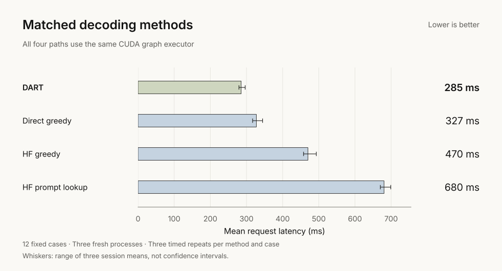
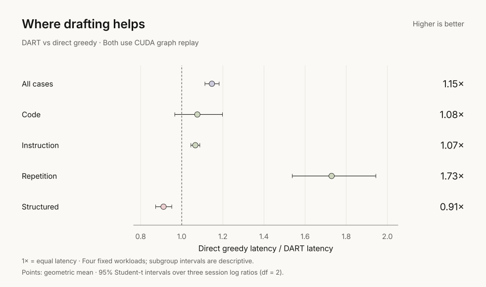
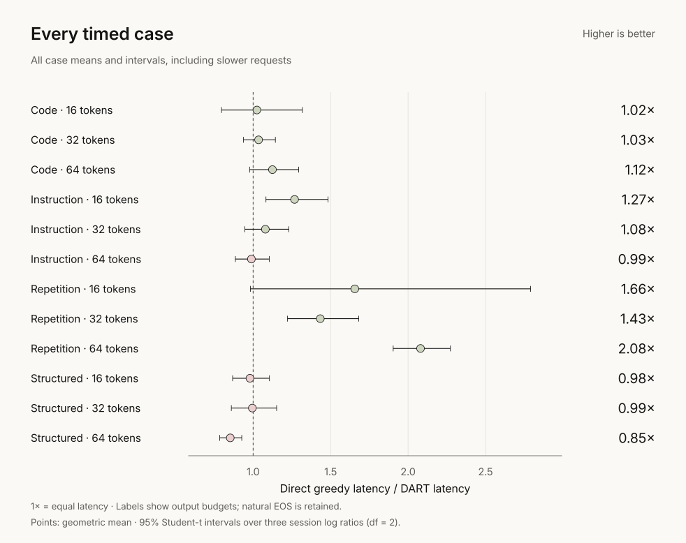

<h1 align="center">DART v0.3</h1>

  <strong>Draft several tokens. Verify them together. Replay the work.</strong> 
  A measured decoding study on Supra-50M. No extra learned weights.

  <a href="#matched-baselines">Results</a> ·
  <a href="#replaying-verification">Implementation</a> ·
  <a href="docs/reproduce.md">Run &amp; reproduce</a> ·
  <a href="#evidence">Evidence</a>

| vs direct greedy | vs eager DART | Full DART outputs |
|:---:|:---:|:---:|
| **12.8% less latency** | **88.1% less latency** | **48 / 48 match** |
| Strongest matched baseline | Same fixed drafting policy | Original HF greedy reference |

51.8M parameters · RTX 5060 Laptop · FP32 · batch one · **warm requests**.
Twelve timed cases, six methods, three fresh processes. One model and machine.

## Matched baselines

**285 ms per request.** Every applicable control receives the same replay
executor, weights and normalization. HF keeps its own generation loop;
both lookup methods use a four-token draft budget and maximum n-gram four.

$$
1-\frac{\overline{T}_{\mathrm{DART}}}{\overline{T}_{\mathrm{greedy}}}
=1-\frac{285.26}{327.24}=12.8\%
$$

The paired session speed ratio is **1.147× [1.113, 1.182]**. This is a
geometric estimate with a 95% interval; the latency reduction above uses
arithmetic means. All three process means improve against direct greedy.

## Replaying verification

Small verification calls repeatedly dispatch the model. DART prepares a
[CUDA graph](https://docs.pytorch.org/docs/2.11/notes/cuda.html#cuda-graphs)
for each block length, then replays it through fixed buffers.
**Static buffers alone do not explain the gain.**

The [implementation](dart/models/replay.py) adds request-owned KV snapshots,
valid-prefix masking, rollback after rejected drafts, and retained graph
inputs. Returned logits survive later calls. The eager path remains the default.
CUDA graphs are an established technique; DART adapts them to block verification.

**Preparation costs 19.8–24.4 seconds**, outside these warm timings.
Peak allocation is **0.597 GiB**, including two model copies and both
workspaces. These are shared-harness measurements, not per-method cold-start
or memory savings. GPU kernel tracing was unavailable.

## Where drafting helps

Repetition provides the largest measured benefit. **Structured requests take
9.7% longer than direct greedy**; the code-workload interval crosses parity.
All four workload means improve against eager DART.

## Every timed case

**8/12 case means beat direct greedy.** Three structured cases and the
64-token instruction case lose. The 32-token structured case stops naturally
after 13 tokens; it stays in the results. No final cases or timings were removed.

## Verified drafting

**Copy a draft → verify → keep the matching prefix → correct or continue.**

$$
t_i=\arg\max_v P_\theta(v\mid p,d_{<i}),
\qquad \mathrm{commit}=(d_1,\ldots,d_m,t_{m+1})
$$

Here $m$ is the matching draft prefix. A full match adds a bonus token;
accepted EOS stops immediately. Rejected KV entries are cropped, and the
last emitted token stays pending. Context and output budgets bound each round.

## Evidence

| Check | Recorded scope |
|:---|:---|
| Outputs | 48 unique DART cases; 936 checks, warm-ups and timed outputs matched |
| Timing | 648 timed requests; three processes; rotating order; 26.7 minutes total |
| Fresh inputs | MBPP, Dolly and procedural cases; source/family and lexical checks |
| Reproduction | Fresh dependency install; 76 validation matches; identical rebuilt SVGs |
| Resources | Existing 51.8M target; zero learned parameters added; 1,024-token context |

Intervals describe three processes on a shared laptop and fixed inputs,
not population uncertainty. Subgroup intervals are descriptive. Numerical
agreement on these cases is not a proof for every input. No answer-quality,
larger-model, compiled-model or independent-reproduction claim.

[Protocol & raw sessions](benchmarks/results/v0.3-execution) ·
[Analysis](benchmarks/results/v0.3-execution/analysis.json) ·
[Development & failures](benchmarks/results/v0.3-execution/development.json) ·
[Reproduction record](benchmarks/results/v0.3-execution/reproduction.json)

**[Run the checks, benchmark and chart commands →](docs/reproduce.md)**

[Earlier normalization study](https://github.com/tugrapaydiner/dart/blob/63411869e4a8ed832c0cc4c1ecb560801625d84e/README.md)
and [v0.2 experiments](https://github.com/tugrapaydiner/dart/tree/v0.2) use
different protocols. They are preserved, not a direct version-speed comparison.

[Apache-2.0 code](LICENSE) · [Dataset attribution](benchmarks/fixtures/verification-sources.json) ·
[Cite DART](CITATION.cff)
