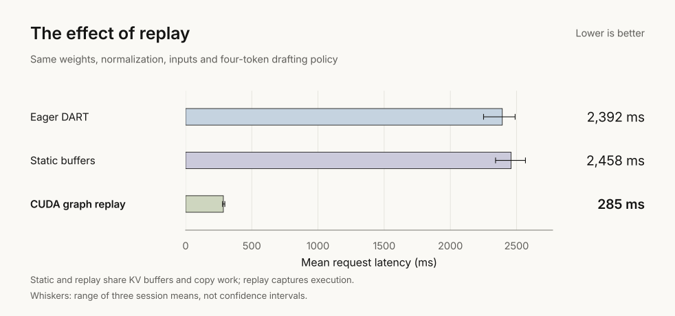

<h1 align="center">DART v0.3</h1>

  <strong>Draft several tokens. Verify them together. Replay the work.</strong> 
  An inference engineering study on Supra-50M. No extra learned weights.

  <a href="#matched-baselines">Results</a> ·
  <a href="#replaying-verification">Implementation</a> ·
  <a href="docs/reproduce.md">Run &amp; reproduce</a> ·
  <a href="#evidence">Evidence</a>

| vs direct greedy | Removing unused feedback | Full output checks |
|:---:|:---:|:---:|
| **22.7% less latency** | **7.6% less latency** | **4,176 / 4,176 match** |
| Excluding synthetic repetition | Same-policy ablation, all 48 cases | Complete IDs, lengths and EOS |

51.8M parameters · RTX 5060 Laptop · FP32 · batch one · **warm requests**.
48 fresh cases, seven methods, three fresh processes. One model and machine.

## Matched baselines

All four paths share the replay executor, weights and normalization.
HF retains its generation loop. Both lookup methods use draft length four
and maximum n-gram four.

$$
1-\frac{\overline{T}_{\mathrm{DART}}}{\overline{T}_{\mathrm{greedy}}}
=1-\frac{82.83}{107.12}=22.7\%
$$

The paired geometric speed ratio is **1.293× [1.276, 1.309]**.
This descriptive 95% interval covers three process means on these fixed inputs.

## Remove unused work

Fixed drafting was calculating entropy that nobody consumed. DART now skips
that distribution calculation and host conversion when neither drafter nor
scheduler needs it. Consumers retain the signal; the ablation switches it back on.

**80.3 → 74.2 ms**, a 7.6% reduction across all 48 cases.
Fixed2 measured **79.3 ms**; the existing TimeScheduler measured **84.2 ms**
with the same optimization. Fixed4 was selected on development inputs.

## Where drafting helps

All four workload means improve. The full-set latency reduction is **31.9%**;
repetition contributes **47.6% of saved time**. The headline excludes that workload.
This does not imply generated text is free of repetition.

**46/48 case means win.** Instruction cases 06 and 09 take **3.7% and 11.8%
longer**. Both case intervals cross parity. Five cases stop naturally at EOS.
No final cases or timings were removed.

## Replaying verification

The earlier execution experiment isolated the foundation: replay, with the
same buffers and copies. **Different inputs; a separate study.**

The [executor](dart/models/replay.py) adds request-owned KV snapshots,
valid-prefix masking, rejection rollback and retained graph inputs.
Returned logits survive later calls. The eager path remains the default.
[CUDA graphs](https://docs.pytorch.org/docs/2.11/notes/cuda.html#cuda-graphs)
are established; DART adapts them to block verification.

**Draft → verify → keep the matching prefix → correct or continue.**

$$
t_i=\arg\max_v P_\theta(v\mid p,d_{<i}),
\qquad \mathrm{commit}=(d_1,\ldots,d_m,t_{m+1})
$$

Here $m$ is the matching draft prefix. EOS and context/output budgets bound
each round; rejected cache entries are cropped.

## Evidence

| Check | Recorded scope |
|:---|:---|
| Timing | 3,024 timed requests; rotated ordering; 9.6 minutes total |
| Inputs | 48 fresh MBPP, Dolly and procedural cases; all timed |
| Correctness | 144 checks + 1,008 warm-ups + 3,024 timed outputs matched HF |
| Reproduction | Fresh isolated install; 352 validation matches; identical rebuilt SVGs |
| Resources | Zero added parameters; 1,024-token context; 0.589 GiB peak allocation |

Preparation is excluded from warm timings. Memory includes two model copies
and the shared workspace, not standalone method memory. Absolute times changed
across processes on this shared laptop. No independent reproduction, GPU kernel
timeline, answer-quality, compiled-model or larger-model result is claimed.

[Protocol & raw sessions](benchmarks/results/v0.3-feedback) ·
[Analysis](benchmarks/results/v0.3-feedback/analysis.json) ·
[Development](benchmarks/results/v0.3-feedback/development.json) ·
[Reproduction](benchmarks/results/v0.3-feedback/reproduction.json)

**[Run the checks, benchmark and chart commands →](docs/reproduce.md)**

The [earlier execution study](benchmarks/results/v0.3-execution) had much more
concentrated gains. Its inputs differ: only the new matched entropy ablation
isolates the 7.6% change. [v0.2](https://github.com/tugrapaydiner/dart/tree/v0.2)
and the [normalization study](https://github.com/tugrapaydiner/dart/blob/63411869e4a8ed832c0cc4c1ecb560801625d84e/README.md)
remain separate experiments.

[Apache-2.0 code](LICENSE) · [Dataset attribution](benchmarks/fixtures/feedback-sources.json) ·
[Cite DART](CITATION.cff)
