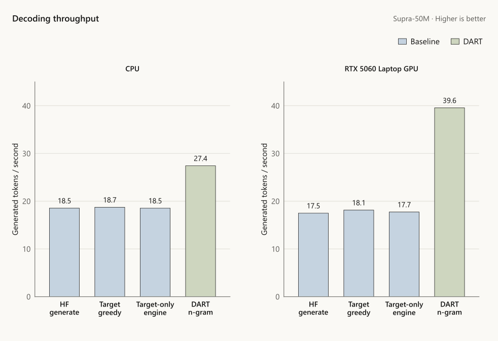
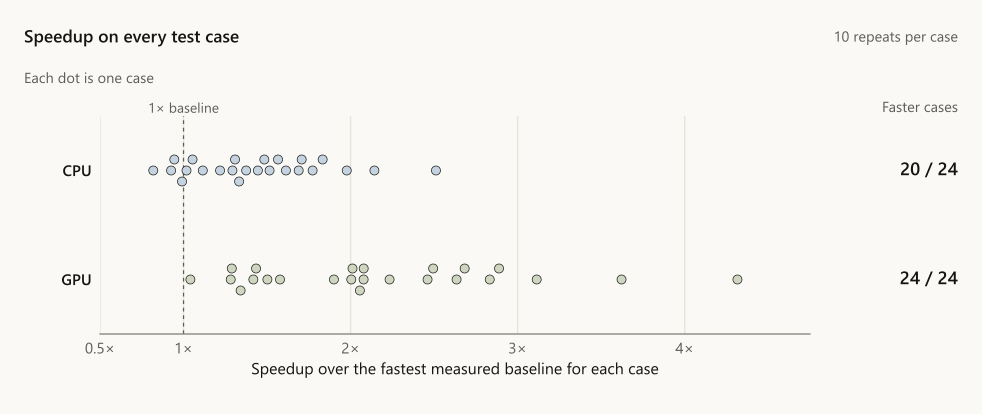
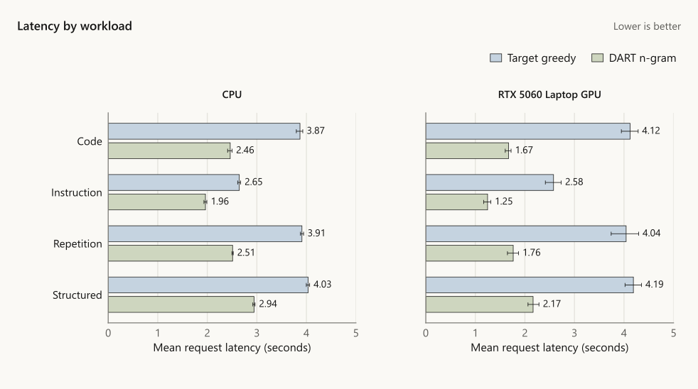
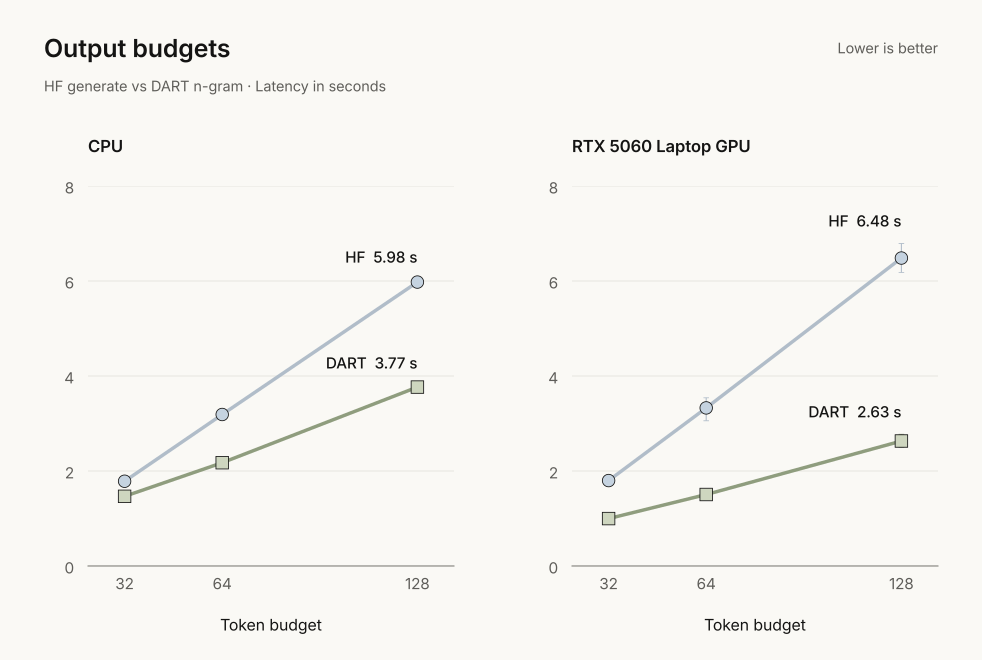
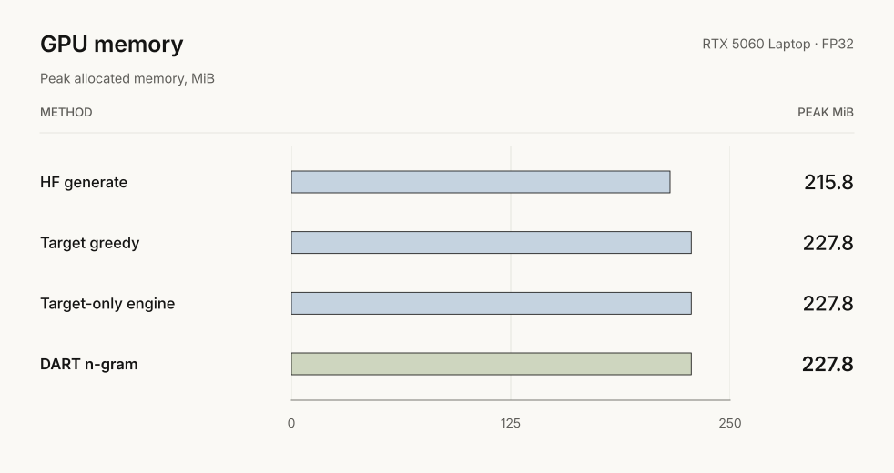
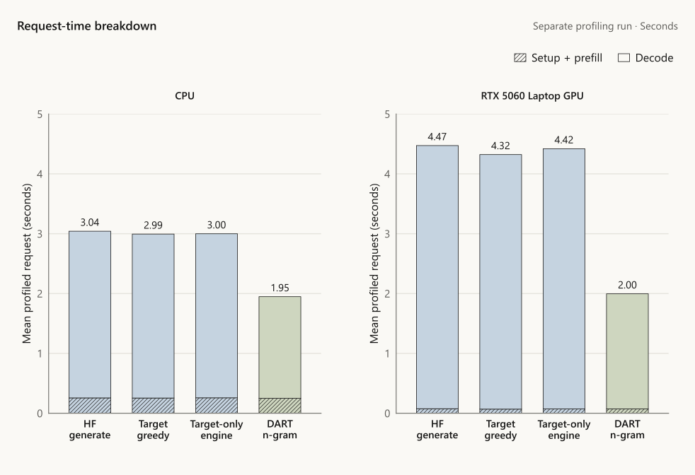
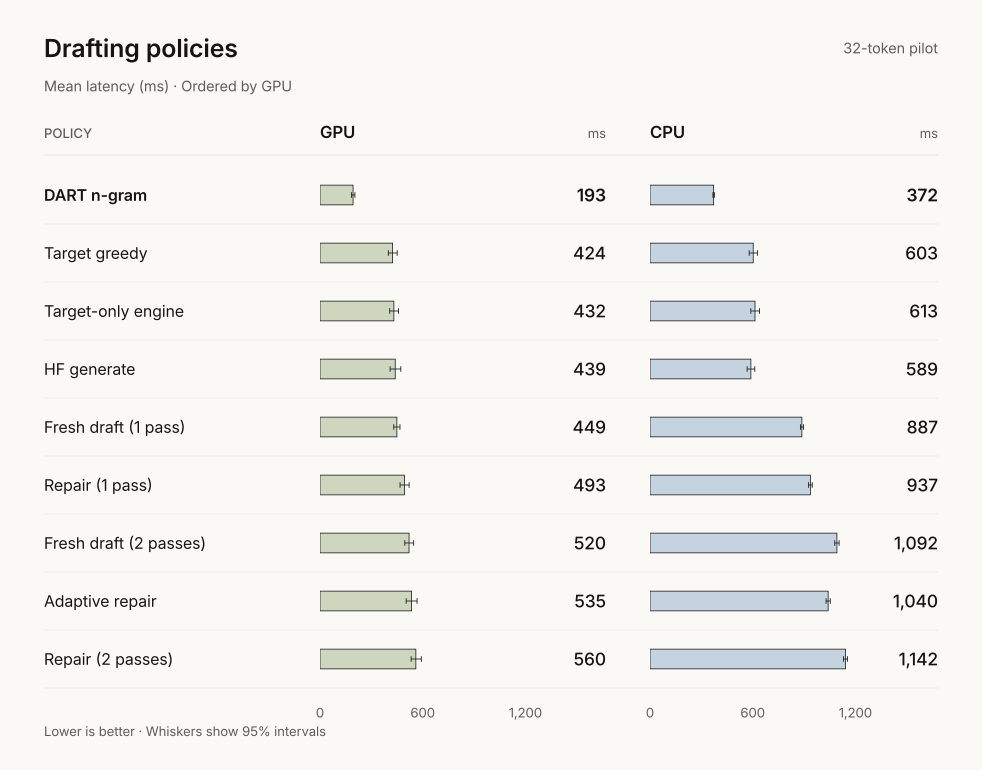

# DART v0.2

Draft several tokens, then let the target verify them.
Faster greedy decoding on the local Supra-50M model.

`FP32 · one sequence · 4-token n-gram drafts · 1,024-token context`

## Benchmarks



**2.18× GPU · 1.46× CPU** vs the fastest measured target-only baseline.
All four methods use the same weights, prompts and output limits.

24 test cases · 10 repeats · **128/128 complete HF outputs matched per device**.
All 960 timed and 192 profiled outputs per device matched too.

<details>
<summary>Speedup on every test case</summary>



Each case uses its fastest baseline: HF generate, direct target greedy or the
target-only engine. Points compare mean latency over ten repeats on these 24 fixed cases.

</details>

## Workloads



## Output budgets



At 32 tokens, CPU speedup was **1.21×**; the **1.25×** target was missed.

## GPU memory



**227.8 MiB** for DART · **215.8 MiB** for HF generate.
Peak PyTorch allocations; total device memory use is outside this measurement.

<details>
<summary>Where request time goes</summary>



Separate diagnostic requests: 24 cases, two repeats, with phase synchronization.
These instrumented timings are excluded from the headline speedups.

</details>

## Learned drafting

**2.08M parameters · acceptance 5.76% → 12.45% · one training seed.**
No learned policy beat the fastest target-only baseline in the pilot aggregate.
The 10% repair latency target was missed.

<details>
<summary>Compare all drafting policies</summary>



Separate four-case validation pilot, with a 32-token budget.
These timings use a different case set from the final benchmark above.
One row per policy, ordered by GPU latency. Whiskers show 95% intervals.

</details>

[Protocol](benchmarks/results/v0.2/protocol.json) ·
[All results](benchmarks/results/v0.2/summary.json) ·
[Outputs](benchmarks/results/v0.2/correctness.json) ·
[Raw timings](benchmarks/results/v0.2/timings.json) ·
[Pilots & failures](benchmarks/results/v0.2/validation-pilots.json)

## Run

Use a local **HF-format Supra-50M-Instruct** folder as `MODEL_DIR`.
GGUF is unsupported. These commands require the [project dependencies](pyproject.toml)
already installed; they do not download a model.

```sh
python -m pip install --no-build-isolation --no-deps .
dart --version
dart check --model "MODEL_DIR" --device cuda
dart bench --model "MODEL_DIR" --device cuda --warmup 1 --repeats 2
dart demo --model "MODEL_DIR" --device cuda
```

`--device cpu` selects CPU. Check correctness before timing.
Demo: `http://127.0.0.1:8400` · stop with Ctrl+C.
The two-repeat benchmark is a smoke run.

## Limits

- One model, one machine, procedural prompts. Repetitive outputs favor n-gram copying; speed is not answer quality.
- Tested presets: FP32, CPU/SDPA and CUDA/eager. CUDA bfloat16/eager failed a token/EOS comparison and is excluded.
- Single-seed pilots: repair and the scheduler were slower; failure-mask training reduced acceptance.

<details>
<summary>Training & resume</summary>

```sh
dart corpus --model "MODEL_DIR" --out runs/corpus/pilot-v1
dart collect --model "MODEL_DIR" --corpus runs/corpus/pilot-v1 --split train --device cuda --max-storage-mib 32 --out runs/traces/train
dart train --model "MODEL_DIR" --traces runs/traces/train --device cuda --steps 200 --out runs/training/part
dart train --model "MODEL_DIR" --traces runs/traces/train --device cuda --steps 400 --resume runs/training/part/latest.pt --out runs/training/resumed
```

Use new output directories. `--steps` includes completed steps; resume with the
same target, traces, device and options. CPU/CUDA resume checks matched
uninterrupted training, including optimizer, RNG and losses.

```text
Corpus    train 192 │ validation 64 │ test 128
Families  disjoint across splits
Context   prompt + output + lookahead ≤ 1,024 tokens
Drafter   2,084,288 learned parameters
```

The selected pilot used 400 steps, seed 17 and the installed training defaults.
Keep test data out of configuration selection. After fixing all choices,
compare the initial and trained checkpoints:

```sh
python scripts/run_corpus_eval.py --model "MODEL_DIR" --corpus runs/corpus/pilot-v1 --split test --device cuda --dtype float32 --attention eager --threads 1 --lane compact --draft-len 4 --checkpoint runs/training/part/initial.pt --out runs/eval/initial-test.json
python scripts/run_corpus_eval.py --model "MODEL_DIR" --corpus runs/corpus/pilot-v1 --split test --device cuda --dtype float32 --attention eager --threads 1 --lane compact --draft-len 4 --checkpoint runs/training/resumed/latest.pt --out runs/eval/trained-test.json
```

These checks measure acceptance and full-output agreement, not latency.
Full settings and hashes: [protocol](benchmarks/results/v0.2/protocol.json).

</details>

<details>
<summary>Reproduce the full benchmark</summary>

| Method | What runs |
|---|---|
| HF generate | Hugging Face Transformers `generate`, greedy decoding |
| Target greedy | Direct cached greedy loop |
| Target-only engine | DART with drafting disabled |
| DART n-gram | Four-token copying drafts + target verification |

| Speedup vs fastest baseline | Estimate | Paired 95% interval |
|---|---:|---:|
| CPU | 1.464× | 1.459–1.469× |
| GPU | 2.181× | 2.155–2.212× |

Intervals describe repeated measurements of these fixed cases and the
observed fastest baseline; they do not establish results on new tasks or machines.

Save as `benchmark_release.py`. It selects the first sorted ID for every
test-family/budget pair: 8 families × 3 budgets = 24 cases.

```python
import json
import sys
from pathlib import Path

import torch

from benchmarks.corpus_bench import benchmark_corpus
from dart.data.pilot import build_pilot
from dart.presets import supra_config
from dart.runtime.factory import build_engine

output = Path(sys.argv[3])
timing_output = output.with_suffix(".timing.json")
if output.exists() or timing_output.exists():
    raise FileExistsError("Choose new report paths")
output.parent.mkdir(parents=True, exist_ok=True)

def save_timing(report):
    with timing_output.open("x", encoding="utf-8") as stream:
        json.dump(report, stream, indent=2)

torch.set_num_threads(1)
torch.manual_seed(17)
torch.set_float32_matmul_precision("highest")
assert not torch.are_deterministic_algorithms_enabled()
records = sorted((row for row in build_pilot(17) if row.split == "test"), key=lambda row: row.id)
selected = {}
for row in records:
    selected.setdefault((row.family, row.max_new_tokens), row)
cases = sorted(selected.values(), key=lambda row: row.id)
assert len(cases) == 24
with build_engine(supra_config(sys.argv[1], sys.argv[2])) as engine:
    report = benchmark_corpus(engine, cases, warmup=2, repeats=10, seed=17, on_timing=save_timing)
with output.open("x", encoding="utf-8") as stream:
    json.dump(report, stream, indent=2)
```

```sh
dart check --model "MODEL_DIR" --device cpu --split test
python benchmark_release.py "MODEL_DIR" cpu runs/cpu-timing.json
dart check --model "MODEL_DIR" --device cuda --split test
python benchmark_release.py "MODEL_DIR" cuda runs/cuda-timing.json
```

| Setting | Value |
|---|---|
| Baselines | HF greedy · direct target greedy · target-only engine |
| Timing | 2 warm-ups · 10 repeats · rotating method order |
| Profiling | 2 separate repeats; excluded from request timing |
| Excluded | Loading · tokenization · correctness checks · warm-up |
| Prompt lengths | Timing: 30–101; full correctness: 30–527 tokens |
| Generation budgets | 32 / 64 / 128 tokens |
| Runtime on tested machine | CPU ~84 min; GPU ~87 min |

CUDA timing is synchronized. Ratios use the fastest observed baseline in
each group. Checked timings are saved to `.timing.json` before profiling;
the final report requires profiling to finish.

The earlier GPU attempt stopped during profiling and lost its numeric timings.
Only the completed retry contributes GPU latency results; settings and inference
code were unchanged. [Protocol and run history](benchmarks/results/v0.2/protocol.json).

</details>

<details>
<summary>Environment & validation scope</summary>

| Item | Tested |
|---|---|
| OS / GPU | Windows 11 / RTX 5060 Laptop |
| Python / PyTorch | 3.13.14 / 2.11.0+cu128 |
| Transformers | 5.16.1 |
| NumPy / PyYAML / safetensors | 2.5.2 / 6.0.3 / 0.8.0 |
| Threads / precision | 1 / FP32 |
| Peak allocated GPU memory, timed benchmark | 227.84 MiB |

Package checks used a fresh project environment with existing system dependencies:

```sh
python -m venv --system-site-packages .venv
```

Activate with `.venv\Scripts\Activate.ps1` (PowerShell) or
`source .venv/bin/activate` (POSIX), then use the install command above.
Broader dependency versions have not been independently tested.

Default `dart check`: 64 validation prompts. Default `dart bench`: four
validation cases. Final results above use 128 test prompts and 24 timing cases.

CPU/correctness revision: `fc0c81c`. GPU timing-save revision: `d8e6beb`.
The latest full suite passed 782 tests with five skips and 21 warnings.
The skips cover optional Triton and an
unavailable tiny-GPT2 checkpoint. Actual Supra checks are listed above.
The 44 later checks cover the timing-save fix, not another full-suite run.

`greedy_verified` describes the engine's mode; independent agreement requires
`dart check`. Precision and attention kernels can change token decisions.

</details>

---

Built on [speculative decoding](https://arxiv.org/abs/2211.17192).
Repair uses token anchors; it does not reproduce
[ReTrace's hidden-state repair](https://arxiv.org/abs/2608.29748v2).

[Apache-2.0](LICENSE) · [Cite DART](CITATION.cff) · Target weights and trained
checkpoints are not included in the v0.2 package.
