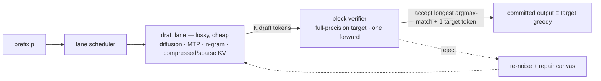
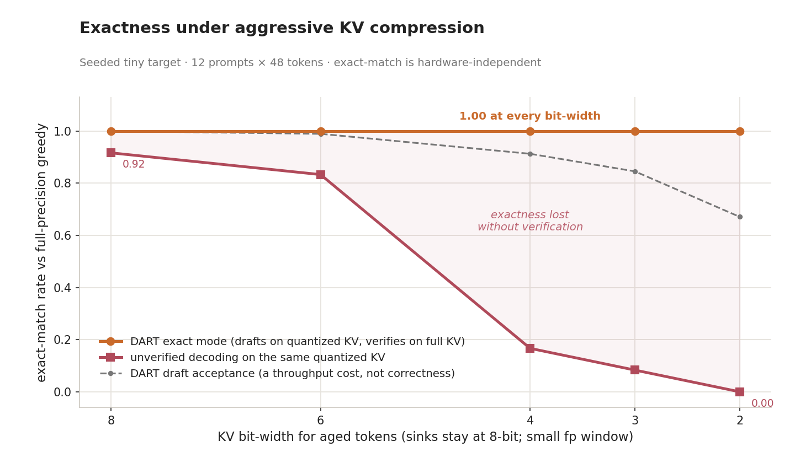
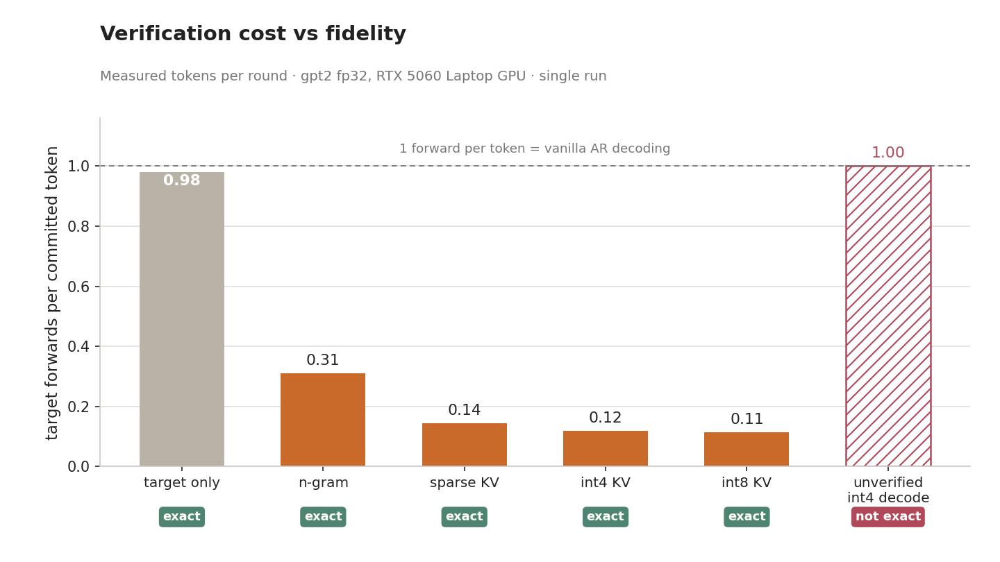
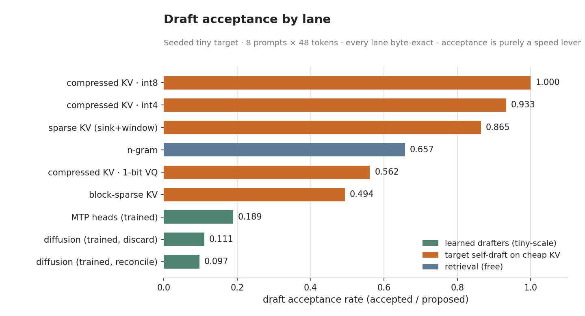
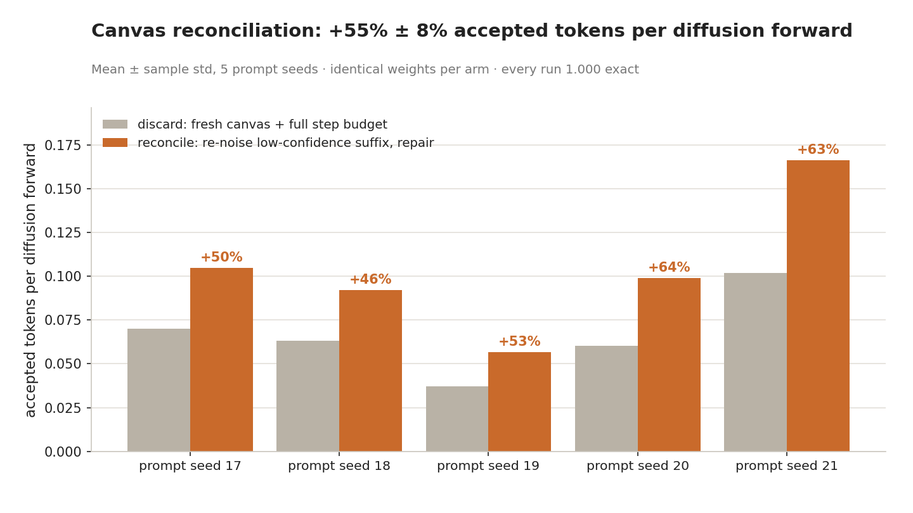
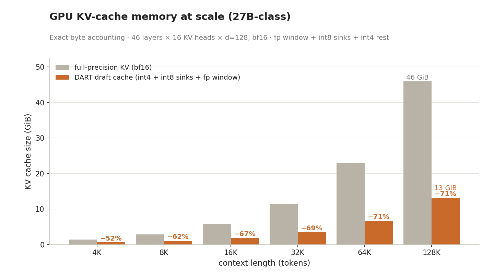
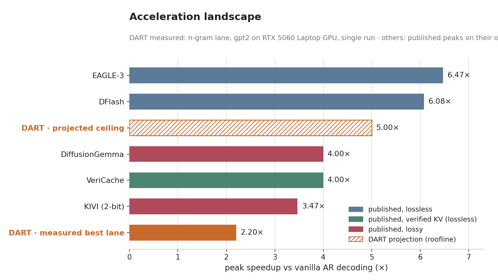
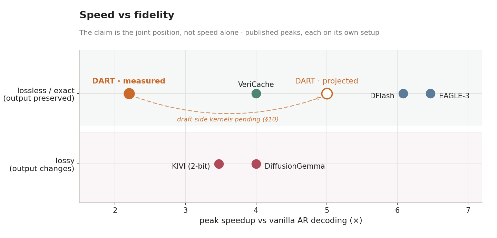
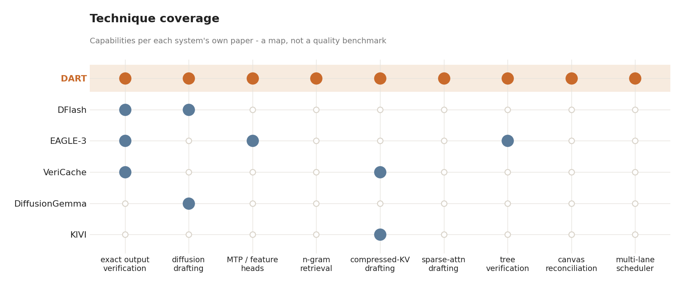

# DART: Diffusion-Augmented Reliable Transformer Serving

[](https://github.com/tugrapaydiner/dart/actions/workflows/ci.yml)


> **Abstract.** DART is a single-sequence inference engine that decouples
> *throughput* from *fidelity*: lossy draft lanes — block-diffusion canvases,
> multi-token-prediction (MTP) heads, n-gram retrieval, and compressed- or
> sparse-KV self-drafting — propose token blocks that a full-precision target
> verifies in one forward pass, committing only tokens that coincide with the
> target's own argmax. Exact mode is therefore byte-identical to the target's
> greedy decode by construction and independent of weights, so drafter error is
> a throughput cost, never a quality one. We add *canvas reconciliation*, a
> diffusion-specific recovery step that re-noises and repairs the unverified
> canvas suffix after a rejection instead of redrafting it, raising
> accepted-tokens-per-diffusion-forward by +55% ± 8% (mean ± sample std over
> 5 prompt seeds, min +46%) while preserving exactness, and *tree
> verification*, which decides among several candidate branches in one
> target forward. The contract is discharged by a
> weight-independent verifier-equivalence suite and validated byte-exact
> against Hugging Face greedy decoding on a real checkpoint, on CPU and CUDA;
> on an RTX 5060 (gpt2, fp32, code prompts) the n-gram lane measures **2.20×**
> wall-clock over the same-run greedy baseline with every lane byte-exact
> (§10).

---

## 1. Method

Decoding proceeds in rounds over a single sequence. Each round selects a lane,
draws a block of $K$ candidate tokens, runs the target once over the committed
prefix concatenated with the block, commits the maximal verifier-consistent
prefix plus one target token, and — for the diffusion lane — reconciles rather
than discards the rejected suffix. The engine maintains the invariant that the
target KV cache covers every committed token except the pending one, which is
re-folded into the next verification pass; greedy decoding is the degenerate
$K{=}0$ instance of the same path.



*Figure 1: The draft → verify → commit loop. Lanes are advisory; only the
verifier emits tokens, so lossy compute moves throughput, not output.*

---

## 2. Exactness contract

Under greedy decoding the engine is observationally equivalent to the target:

$$
\mathrm{DART}_{\mathrm{exact}}(x_{1:n}) \;=\; \mathrm{Target}_{\mathrm{greedy}}(x_{1:n}),
$$

token-for-token, including whitespace, structured-output delimiters, and the
stop token. The property is verifier-induced rather than weight-induced — every
committed token is, by definition, the target's full-precision argmax at that
position — so it holds for arbitrary (including randomly-initialised) weights and
transfers across checkpoints without retuning.

Three verifiers bound the implementation. A reference verifier decides one
token per single-token forward; a block verifier decides $K{+}1$ tokens per
forward; a tree verifier decides among several candidate branches in one
forward (§3). The suite asserts bitwise-identical commit sequences and
identical KV lengths between the reference and block verifiers across
adversarial, constant, oracle, n-gram, diffusion, compressed-KV and sparse
drafters, pins the tree verifier to the block verifier by an enforced
equivalence on chain-shaped trees, and asserts equality to the target
baseline throughout.

Ablating the verifier isolates its role: direct decoding on a quantised KV cache
drifts from the target as precision drops, whereas DART, which uses the same
cache only to draft, does not.



*Figure 2: Exact-match rate against the target greedy, measured per bit-width
([exactness_vs_bits.md](benchmarks/results/exactness_vs_bits.md)). Unverified
compressed-KV decoding degrades to zero as bit-width falls; the verified path
stays at 1.0 while quantisation error surfaces as acceptance, not output.*

---

## 3. Block verification

For prefix $p$ and a proposed block $d_1,\dots,d_K$, a single causal forward over
the concatenation yields the target next-token distribution at every position.
Writing the target's own continuation and the longest consistent prefix as

$$
t_i \;=\; \arg\max\,\mathrm{Target}(p, d_1, \dots, d_{i-1}),
\qquad
m \;=\; \min\{\, i : d_i \neq t_i \,\} - 1,
$$

the round commits

$$
d_1, \dots, d_m,\; t_{m+1}
\qquad\text{(and a free bonus } t_{K+1}\text{ when } m = K).
$$

An accepted EOS terminates the round without a correction. KV entries for the
rejected suffix are rolled back by cropping the cache to length $|p| + m$, which
re-establishes the round invariant. Because baseline and accelerated decoding
share this code path, they cannot diverge by implementation; the only free
parameter is how many of the $K{+}1$ committed tokens a single forward yields.

**Tree verification** generalizes the block to several candidate branches
sharing prefixes, packed into one forward with a tree-structured attention
mask and depth-based position ids. The target's argmax walk selects at most
one root-to-leaf path; the longest matching path is committed plus the usual
correction or bonus, and the accepted path's KV entries are gathered out of
the packed tail — valid because a packed node's K/V depend only on the prefix
and its ancestor chain. A chain-shaped tree coincides with block verification
decision-for-decision (enforced in tests). Enabled with
`DartEngine(verifier="tree")`; the n-gram lane proposes multiple historical
continuations as branches, and drafters without tree support degrade to
chains. Exact (greedy) mode only; requires a model honoring custom 4D
attention masks (Llama-family, eager attention).



*Figure 3: Target forward passes per output token (matched model, prompts and
hardware). Exact methods fall below 1.0; an unverified compressed-KV decode is
no cheaper and forfeits exactness.*

---

## 4. Draft lanes

Lanes are interchangeable behind the verifier; they differ only in how cheaply
they approximate the target's argmax continuation. The operative metric is the
acceptance rate $a$ (confirmed / proposed tokens), which sets committed tokens
per round (§10).

| Lane | Mechanism | Draft cost / round |
|---|---|---|
| `ngram` | longest-suffix match in context, continuation copied forward | retrieval only |
| `mtp` | learned heads predicting offsets $+2,+3,\dots$ from one target hidden state | one head pass |
| `diffusion` | bidirectional masked canvas, denoised in parallel, trained for acceptance (§5) | $s$ denoise passes |
| `compressed_kv` | target self-drafting on an INT4 / INT8 / 1-bit-VQ KV cache | $K$ rolls, compressed KV |
| `sparse_kv` | sink + sliding-window token-drop attention; cost flat in context length | $K$ rolls, compacted seq |
| `block_sparse_kv` | top-$k$ context blocks by embedding relevance (MSA-style) | $K$ rolls, selected blocks |

The KV lanes have the target draft on a cheaper cache (trading per-forward
bandwidth); the retrieval/MTP lanes cut forward *count* instead. A scheduler
arbitrates between them online (§9).



*Figure 4: Per-lane acceptance on the tiny target
([cpu_bench_tiny.md](benchmarks/results/cpu_bench_tiny.md)). All lanes are
exact; acceptance is purely a speed lever.*

---

## 5. Diffusion drafter and training objective

The diffusion lane denoises a fixed-length masked canvas conditioned on a
right-aligned context window, via a compact bidirectional encoder. Denoising
uses a MaskGIT-style cosine schedule with confidence-thresholded commits and
adaptive early stopping. The drafter is optimised for *verifier acceptance*, not
perplexity: a fluent but non-argmax token has zero value in exact mode. Training
minimises a masked-denoising cross-entropy, a temperature-scaled KL to the
target, a token-level cross-entropy to the target argmax (the acceptance term),
and a confidence-calibration BCE:

$$
\mathcal{L} \;=\; \mathcal{L}_{\mathrm{den}} \;+\; 0.3\,\mathcal{L}_{\mathrm{kl}} \;+\; 0.5\,\mathcal{L}_{\mathrm{acc}} \;+\; 0.1\,\mathcal{L}_{\mathrm{cal}}.
$$

The acceptance term carries the largest weight; the calibration term makes
per-slot confidence a usable acceptance estimator, which in turn drives adaptive
stopping and the confidence-gated re-masking of §6. Supervision comes from
teacher traces (target greedy continuation, per-token logits, entropy) corrupted
into noisy canvases under masking, random-token, entropy-weighted,
span-permutation, and syntax-aware noise.

---

## 6. Canvas reconciliation

After a rejection, an autoregressive draft suffix is conditioned on an overruled
token and is discarded wholesale. A bidirectional canvas admits partial reuse.
With $m$ slots accepted out of $K$, the prefix and correction enter the context,
and the unverified suffix is re-masked at its low-confidence slots and repaired
under a reduced step budget $r \ll s$ rather than redrawn:

$$
\underbrace{d_{m+1},\dots,d_K}_{\text{unverified suffix}}
\;\xrightarrow{\text{re-mask low-confidence slots}}\;
\text{repair in } r \ll s \text{ denoise passes}.
$$

Slots below a confidence threshold are re-masked; if too few qualify, the
lowest-confidence slots are re-masked up to a cap. Joint refinement makes the
stale suffix a strong initialisation, so repair dominates a cold redraft in
accepted-tokens-per-FLOP. The verifier still gates every repaired token, so the
optimisation is throughput-only.



*Figure 5: Reconcile vs the discard/redraft baseline, both exact (bars show
prompt seed 17). Across 5 prompt seeds reconciliation lifts
accepted-tokens-per-diffusion-forward by +55% ± 8% (min +46%);
per-seed table in
[reconciliation_ablation.md](benchmarks/results/reconciliation_ablation.md).*

---

## 7. Verified KV-cache compression

In the long-context, batch-1 regime the KV cache dominates HBM traffic. For $L$
layers, $H$ key/value heads, head dimension $d$, $s$ tokens and $b$ bytes per
element, the full and DART caches are

$$
\mathrm{KV}_{\mathrm{full}}(s) = 2\,L\,H\,d\,s\,b,
\qquad
\mathrm{KV}_{\mathrm{DART}}(s) = 2\,L\,H\,d\,\big[\, w\,b_{\mathrm{hi}} + (s-w)\,b_{\mathrm{lo}} \,\big],
$$

where the leading factor 2 covers keys and values, $w$ is the full-precision
sink + recent window, and the remaining tokens are stored at the low bit-width.
A precision policy raises bit-width per token or per layer for attention sinks,
the first/last layers, structural delimiters, and high-entropy positions, taking
the maximum applicable width. The full-precision verifier cache may reside in
pinned host memory and stream device-ward per round, overlapped with the next
round's drafting, so device residency is the compressed cache alone. Aggressive
quantisation is admissible precisely because verification runs on full KV:
dequantisation error perturbs $a$, not the committed token.



*Figure 6: Exact byte accounting for a 27B-class configuration (46 layers ×
16 KV heads × d=128, bf16 baseline; fp window 1024 + int8 sinks + int4 rest,
including fp32 scale/zero overhead); reduction rises with context as the
fixed full-precision window amortises — 71% at 128K.*

---

## 8. Distribution-exact sampling

Greedy verification compares argmaxes. To preserve the target's full sampling
distribution rather than only its mode, DART applies speculative sampling: a
draft $d$ drawn from proposal $q$ is accepted with probability $\min(1, p(d)/q(d))$,
a rejection resamples from the normalised positive residual, and full acceptance
draws a bonus from the target. Token-only lanes are treated as one-hot proposals
($q(d){=}1$), for which acceptance reduces to $p(d)$:

$$
\alpha(d) = \min\!\Big(1, \tfrac{p(d)}{q(d)}\Big),
\quad
d' \sim \frac{(p-q)^{+}}{\lVert (p-q)^{+}\rVert_1},
\quad
\min(p,q) + (p-q)^{+} = p.
$$

The identity on the right gives marginal correctness: the emitted token is
distributed exactly as $p$. This is a distributional guarantee, not a trace-level
one, and metadata flags it (`exact_greedy_equivalent: false`,
`distribution_exact: true`).

---

## 9. Online lane scheduling

A scheduler maps a decode state (context length, prompt class, device headroom,
per-lane acceptance EWMAs) to a lane each round. The default is a heuristic with
sticky rejection-based fallback; a UCB contextual bandit is also provided, with
per-lane reward

$$
\mathrm{reward}(\ell) = \frac{\text{committed tokens}}{\text{round latency}}
\;-\; \lambda_{\mathrm{rej}}\,\rho_{\mathrm{rej}}
\;-\; \lambda_{\mathrm{mem}}\,m_{\mathrm{KV}}
$$

i.e. accepted-tokens-per-second penalised by the rejection fraction and the
observed per-lane KV footprint, with hard constraints that bench any lane
breaching a rejection-rate or KV-budget ceiling.
Scheduling is advisory: a poor arm costs latency, not correctness.

---

## 10. Measured results and the speedup bound

Measured on an NVIDIA RTX 5060 Laptop GPU (gpt2, fp32, eager attention,
6 code prompts × 64 tokens, draft length 8; `speedup` is wall-clock against
the same-run trusted greedy baseline — same model, device, prompts). One
run per lane; exactness is gated per run, but run-to-run wall-clock
variance has not been characterized. Full artifact:
[gpu_bench_rtx5060.md](benchmarks/results/gpu_bench_rtx5060.md).

| lane | exact match | acceptance | tokens/round | speedup |
|---|---|---|---|---|
| target_only | 1.000 | — | 1.02 | 1.03× |
| **ngram** | **1.000** | 0.395 | 3.23 | **2.20×** |
| compressed_kv_int8 | 1.000 | 0.976 | 8.76 | 0.56× |
| compressed_kv_int4 | 1.000 | 0.931 | 8.42 | 0.54× |
| sparse_kv | 1.000 | 0.745 | 7.00 | 0.51× |
| diffusion (untrained) | 1.000 | 0.000 | 1.02 | 0.54–0.73× |

Two honest readings. The retrieval lane wins outright: 2.20× measured,
byte-exact. The compressed-KV lanes accept almost everything (0.98 at INT8 —
the quantized cache preserves the target argmax) yet *lose* wall-clock here,
because a 124M-parameter target is compute-bound and the draft rolls run in
unfused PyTorch: their operating regime is long-context, memory-bound
decoding, which is precisely what the (not yet GPU-validated) Triton kernels
target. Acceptance transfers across hardware; wall-clock does not.

Under i.i.d. per-token acceptance $\alpha$ at draft length $K$, expected committed
tokens per round follow the standard speculative-decoding result, which equals
the measured block acceptance rate $a$ via $R = 1 + Ka$:

$$
R \;=\; \frac{1 - \alpha^{K+1}}{1 - \alpha} \;=\; 1 + K a .
$$

In the batch-1, memory-bound regime a block-verify costs ≈ one decode step of HBM
traffic, so $R$ upper-bounds the attainable speedup for a near-free drafter:
the compressed-KV rows above are running at $R \approx 8$ committed tokens per
verify, a ceiling the wall-clock will approach only once draft-side kernels
stop being the bottleneck. That ceiling — a roofline *projection*, labelled as
such wherever it appears — situates DART within the published
lossless-acceleration landscape.



*Figure 7: Published peak speedups of comparable lossless methods (their own
hardware/models), with DART's measured lane and projected ceiling shown
separately — a positioning landscape, not a controlled head-to-head.*

---

## 11. Speed–fidelity trade-off

The differentiator is the joint position in (speed, fidelity), not speed alone:
unverified KV quantisation is fast but lossy; speculative methods are exact but
single-technique. DART attains the exact-fidelity tier while composing multiple
techniques behind one verifier.



*Figure 8: Speedup against the fidelity guarantee. DART occupies the
lossless/exact tier at competitive (projected) speedup.*

---

## 12. Technique coverage

The architectural claim is breadth under one contract: a scheduler composes
diffusion, MTP, compressed-KV and sparse lanes round-by-round, with the
canvas-reconciliation step absent from the surveyed systems.



*Figure 9: Technique coverage across systems (from their papers); a capability
map, not a quality benchmark.*

---

## 13. Positioning

DART is a serving layer, not a model: it does not improve answer quality, it
reproduces a chosen target's output at lower cost, and it is not comparable to
hosted chat models on quality — that would be a category error. Its operating
regime is batch-1, long-context decoding, where KV memory binds and the
compression of §7 applies. What it adds over serving the target directly is
byte-exact reproducible output under lossy internal compute, self-hosting, and
composition of acceleration techniques behind one verifier; quality is
inherited from whichever target it serves.

---

## 14. Reproduction

All commands run on CPU against a seeded tiny target (no downloads), since
exactness is weight-independent; set `target.model` to `hf:<name>` for a real
model.

```bash
pip install -e ".[dev]"

pytest                                                  # verifier-equivalence suite
python scripts/run_baseline.py                          # trusted greedy baseline
python benchmarks/run_bench.py                          # per-lane comparison + exact gate
python scripts/run_exact_eval.py --config configs/dart_diffusion.yaml
python scripts/train_drafter.py                         # train the diffusion drafter
python scripts/train_mtp.py                             # train MTP heads
python scripts/run_reconciliation_ablation.py           # the §6 result (multi-seed)
python scripts/measure_exactness_vs_bits.py             # the Figure 2 data
python -m dart.verification.tests --config configs/dart_exact.yaml
python scripts/run_server.py --config configs/target_qwen.yaml   # OpenAI-style API + /demo
python scripts/run_real_model.py --model gpt2           # byte-exact vs HF greedy
python scripts/make_figures.py                          # regenerate ALL figures from artifacts

# the §10 measured-GPU table (any CUDA box; hardware is recorded in the artifact)
python benchmarks/run_bench.py --target hf:gpt2 --device cuda --dtype float32 \
    --prompts-file benchmarks/prompts/code.jsonl --max-new 64 --draft-len 8
```

```python
from dart import DartEngine, DecodeConfig

engine = DartEngine.from_config("configs/dart_exact.yaml")
out = engine.generate("def binary_search(arr, target):\n",
                      DecodeConfig(mode="exact", max_new_tokens=128))
print(out.text, out.metadata)   # acceptance, lanes_used, exact_greedy_equivalent, ...
```

Modes: `exact` (greedy, byte-identical), `exact_sampling` (distribution-exact),
`approx` (verification skipped every $N$-th round; divergence audited in
metadata, never silent).

---

## 15. Repository layout

```
dart/
  runtime/       engine, scheduler, OpenAI-style server, metrics, types
  verification/  reference + block + tree verifiers, speculative sampling
  drafters/      n-gram, MTP, diffusion, compressed-KV, sparse, block-sparse lanes
  diffusion/     canvas, noise schedules, denoise loop, reconciliation, losses
  kv/            quantized cache, INT4/INT8/VQ/token-drop codecs, residency, prefetch
  attention/     sliding-window+global, block-sparse, verifier masks, Triton kernels
  models/        target wrapper, tokenizer bridge, teacher-trace capture
configs/         exact / diffusion / long-context / research-max + target presets
benchmarks/      per-lane harness, workload prompts, committed result artifacts
scripts/         baseline, eval, training, server, real-model validation
tests/           verifier-equivalence and exactness suite
docs/            design document, exactness contract, methodology, result figures
```

---

## 16. Scope and limitations

Batch-1, low-concurrency, long-context serving. Exact-greedy claims are gated by
an exact-match check in every benchmark and test run; sampling exactness is
distributional and Monte-Carlo tested; approx mode self-reports divergence and
never mixes silently with exact mode. Acceptance and KV-memory figures are
measured or exactly computed; wall-clock speedups are measured on the stated
hardware (§10), and frontier-scale ceilings are *projected* from a transparent
batch-1 roofline model and labelled as such, never reported as measured. The
tree verifier is greedy-mode only and requires models honoring custom 4D
attention masks. The Triton kernels ship with CPU-tested reference
implementations and are not yet GPU-validated. See
[docs/exactness_contract.md](docs/exactness_contract.md) and
[docs/design.md](docs/design.md) before quoting numbers.

---

## Citation

If you use DART, please cite it via [CITATION.cff](CITATION.cff).

---

## License

Apache-2.0. See [LICENSE](LICENSE).
